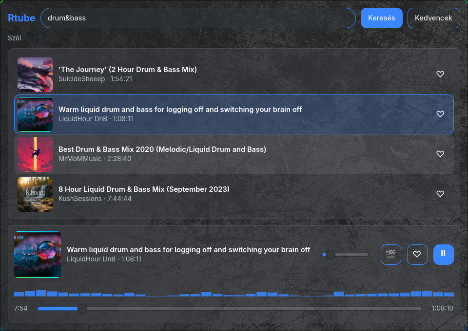
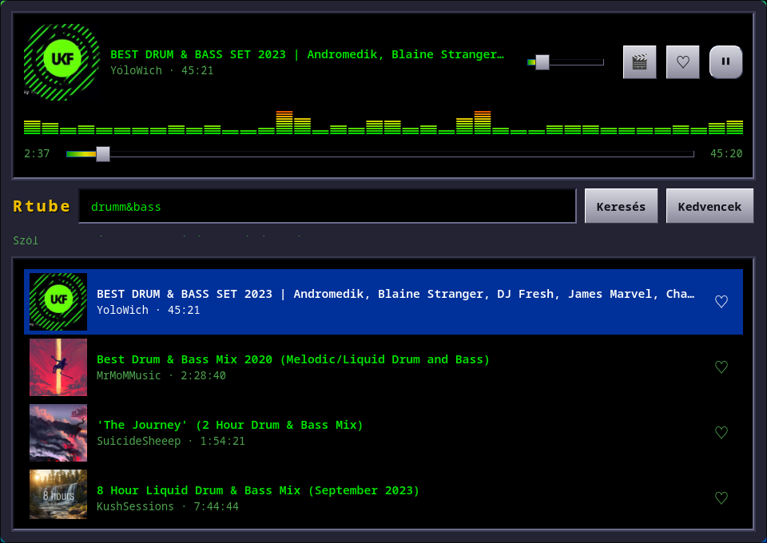

# Rtube

🇬🇧 [English](#english) · 🇭🇺 [Magyar](#magyar)

## English

| Glass | Winamp |
|:---:|:---:|
|  |  |

YouTube search that plays audio only. A GTK4 app for Arch Linux and Ubuntu / Linux Mint with a
frosted-glass look and a classic Winamp skin, plus a small cava spectrum visualizer.

> The app follows the system language (Hungarian or English). Force it with
> `RTUBE_LANG=en` or `RTUBE_LANG=hu`, e.g. `RTUBE_LANG=en rtube`.

### Install

#### Arch Linux

```sh
git clone https://github.com/Mrkovi08/rtube.git
cd rtube
makepkg -si
```

Or download the ready-made package from the [Releases](https://github.com/Mrkovi08/rtube/releases) page and run:

```sh
sudo pacman -U rtube-<version>-1-any.pkg.tar.zst
```

pacman installs the required dependencies automatically (GTK4, GStreamer, yt-dlp...).
Optional extras: `mpv` (open the video), `cava` (spectrum visualizer).

#### Ubuntu / Linux Mint

Download `rtube_1.4.0-1_all.deb` from the [Releases](https://github.com/Mrkovi08/rtube/releases) page,
then double-click it (Software Manager / App Center) or run:

```sh
sudo apt install ./rtube_1.4.0-1_all.deb
```

apt installs everything it needs automatically: Python GTK4 bindings, GStreamer
(with `gstreamer1.0-libav` for YouTube audio), and the recommended `mpv` and `cava`.
Tested on Ubuntu 24.04 / Linux Mint 22.

The yt-dlp in the Ubuntu archive is too old for YouTube, so on first launch Rtube
downloads the latest standalone **yt-dlp** and, if no new enough Node.js (20+) is
installed, **deno** (YouTube's JavaScript runtime) into `~/.local/share/rtube/bin`.
This happens in your user account, without sudo; the status line shows the progress,
and yt-dlp is kept up to date automatically. Your own `~/.config/yt-dlp/config`
(e.g. cookies) is respected. Check the tools any time with `rtube --check-tools`.

### Launch

- `rtube` – glass look
- `rtube --winamp` – Winamp skin

Both also appear in your application menu.

### DMS bar widget (optional)

For DankMaterialShell users:

```sh
mkdir -p ~/.config/DankMaterialShell/plugins
cp -r /usr/share/rtube/dms-plugin ~/.config/DankMaterialShell/plugins/rtube
```

### Uninstall

```sh
sudo pacman -R rtube      # Arch
sudo apt remove rtube     # Ubuntu / Linux Mint
rm -rf ~/.local/share/rtube   # optional: downloaded yt-dlp / deno
```

---

## Magyar

| Üveges | Winamp |
|:---:|:---:|
|  |  |

YouTube kereső, ami csak a hangot játssza. GTK4 alkalmazás Arch Linuxra és Ubuntu / Linux Mintre,
üveges és klasszikus Winamp kinézettel, kis cava spektrumkijelzővel.

> Az alkalmazás a rendszer nyelvét követi (magyar vagy angol). Kényszeríteni a
> `RTUBE_LANG=en` vagy `RTUBE_LANG=hu` változóval lehet, pl. `RTUBE_LANG=hu rtube`.

### Telepítés

#### Arch Linux

```sh
git clone https://github.com/Mrkovi08/rtube.git
cd rtube
makepkg -si
```

Vagy töltsd le a kész csomagot a [Releases](https://github.com/Mrkovi08/rtube/releases) oldalról, és:

```sh
sudo pacman -U rtube-<verzió>-1-any.pkg.tar.zst
```

A pacman magától felrakja a szükséges függőségeket (GTK4, GStreamer, yt-dlp...).
Választható extrák: `mpv` (videó megnyitása), `cava` (spektrum).

#### Ubuntu / Linux Mint

Töltsd le az `rtube_1.4.0-1_all.deb` fájlt a [Releases](https://github.com/Mrkovi08/rtube/releases) oldalról,
majd kattints rá duplán (Szoftverkezelő / App Center), vagy:

```sh
sudo apt install ./rtube_1.4.0-1_all.deb
```

Az apt magától felrak mindent, ami kell: a Python GTK4 csatolókat, a GStreamert
(a YouTube hanghoz szükséges `gstreamer1.0-libav`-val), és az ajánlott `mpv`-t és `cava`-t.
Tesztelve: Ubuntu 24.04 / Linux Mint 22.

Az Ubuntu tárolójában lévő yt-dlp túl régi a YouTube-hoz, ezért az első indításkor
az Rtube letölti a legfrissebb önálló **yt-dlp**-t, és ha nincs elég új Node.js (20+),
a **deno**-t is (a YouTube JavaScript futtatókörnyezete) a `~/.local/share/rtube/bin` mappába.
Ez a saját felhasználói fiókodban történik, sudo nélkül; az állapotsor mutatja a haladást,
és a yt-dlp-t magától frissen tartja. A saját `~/.config/yt-dlp/config` beállításaidat
(pl. sütik) figyelembe veszi. Ellenőrzés bármikor: `rtube --check-tools`.

### Indítás

- `rtube` – üveges kinézet
- `rtube --winamp` – Winamp kinézet

Mindkettő megtalálható az alkalmazásmenüben is.

### DMS sáv widget (opcionális)

```sh
mkdir -p ~/.config/DankMaterialShell/plugins
cp -r /usr/share/rtube/dms-plugin ~/.config/DankMaterialShell/plugins/rtube
```

### Eltávolítás

```sh
sudo pacman -R rtube      # Arch
sudo apt remove rtube     # Ubuntu / Linux Mint
rm -rf ~/.local/share/rtube   # opcionális: a letöltött yt-dlp / deno
```
